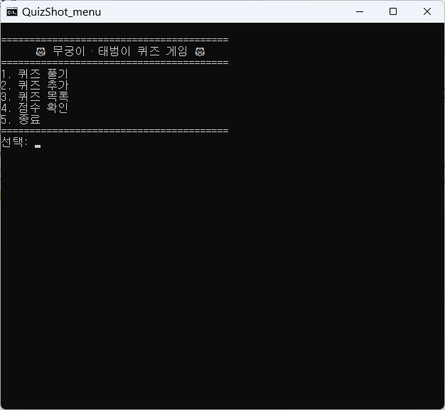
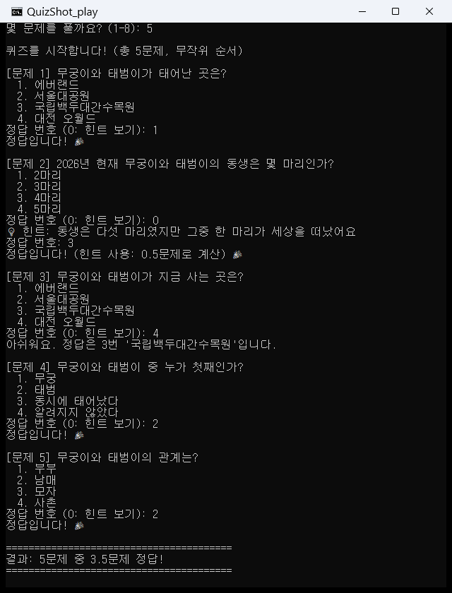
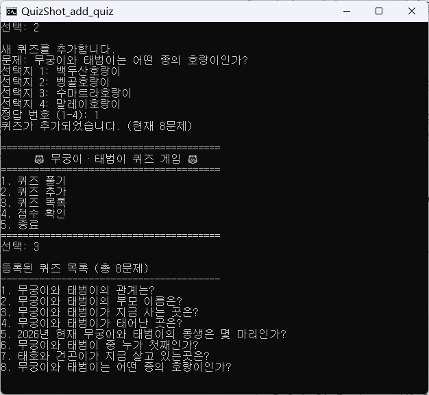
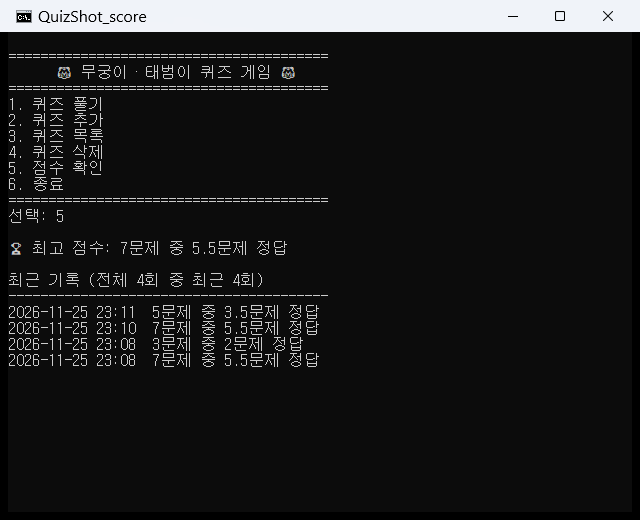

# 무궁이·태범이 퀴즈 게임

## 프로젝트 개요
터미널에서 실행하는 백두산호랑이 남매 무궁이·태범이 퀴즈 게임입니다.
Python 표준 라이브러리만 사용했고, 퀴즈와 최고 점수를 `state.json`에 저장해
프로그램을 다시 실행해도 유지됩니다.

## 퀴즈 주제와 선정 이유
- 주제: 백두산호랑이 남매 무궁이와 태범이
- 선정 이유: 고양이를 좋아해서 고양이 쇼츠를 보다가, 알고리즘이 호랑이 영상을 추천해 주었습니다.
  마침 무궁이와 태범이가 태어났는데 너무 귀여웠고, 사육사들과의 케미를 하나씩 알게 되면서
  좋아하게 되었습니다. 그래서 제가 가장 즐겁게 문제를 만들 수 있는 이 남매를 주제로 골랐습니다.

## 실행 방법
- 필요 환경: Python 3.10 이상 (외부 라이브러리 없음)

```bash
git clone https://github.com/solarjina-geena/E1-2.git
cd E1-2
python main.py
```

## 기능 목록
| 메뉴 | 설명 |
| --- | --- |
| 1. 퀴즈 풀기 | 저장된 퀴즈를 출제하고 정답 여부와 결과를 보여 줍니다 |
| 2. 퀴즈 추가 | 문제, 선택지 4개, 정답 번호를 입력받아 저장합니다 |
| 3. 퀴즈 목록 | 등록된 퀴즈를 번호와 함께 보여 줍니다 |
| 4. 점수 확인 | 최고 점수를 보여 줍니다 |
| 5. 종료 | 저장 후 종료합니다 |

- 입력 오류(빈 입력, 문자, 범위 밖 숫자, 앞뒤 공백)는 안내 후 다시 입력받습니다.
- Ctrl+C나 입력 종료(EOF)가 들어와도 저장한 뒤 안전하게 종료합니다.

## 파일 구조
```text
E1-2/
├── main.py          # 프로그램 시작점: QuizGame을 만들고 실행
├── quiz.py          # Quiz 클래스 (문제 1개)
├── quiz_game.py     # QuizGame 클래스 (메뉴, 풀기, 추가, 목록, 점수, 저장)
├── state.json       # 퀴즈와 최고 점수 데이터 (자동 생성)
├── README.md
├── .gitignore
└── docs/screenshots/
```

| 클래스 | 역할 |
| --- | --- |
| `Quiz` | 문제, 선택지, 정답을 가지고 출력(`display`), 채점(`is_correct`), dict 변환(`to_dict`, `from_dict`)을 합니다 |
| `QuizGame` | 퀴즈 목록과 최고 점수를 가지고 메뉴 진행, 입력 검증, 저장·불러오기를 합니다 |

## 데이터 파일 (state.json)
- 경로: 프로젝트 루트의 `state.json` (UTF-8, 한글 그대로 저장)
- 역할: 퀴즈 목록과 최고 점수를 저장합니다. 파일이 없으면 기본 퀴즈로 시작하고,
  손상되었으면 안내 메시지를 보여 준 뒤 기본 퀴즈로 복구합니다.
- 저장 시점: 퀴즈 추가 직후, 최고 점수 갱신 직후, 프로그램 종료 시

| 필드 | 타입 | 설명 |
| --- | --- | --- |
| quizzes | list | 퀴즈 목록 |
| quizzes[].question | str | 문제 |
| quizzes[].choices | list[str] | 선택지 4개 |
| quizzes[].answer | int | 정답 번호 (1~4) |
| best_score | int 또는 null | 최고 기록의 맞힌 문제 수. 푼 적이 없으면 null |
| best_total | int 또는 null | 최고 기록 때 푼 전체 문제 수 |

```json
{
    "quizzes": [
        {
            "question": "무궁이와 태범이의 관계는?",
            "choices": ["부부", "남매", "모자", "사촌"],
            "answer": 2
        }
    ],
    "best_score": 5,
    "best_total": 6
}
```

최고 점수는 **맞힌 문제 수가 더 많은 기록**으로 갱신됩니다.

## 실행 화면




